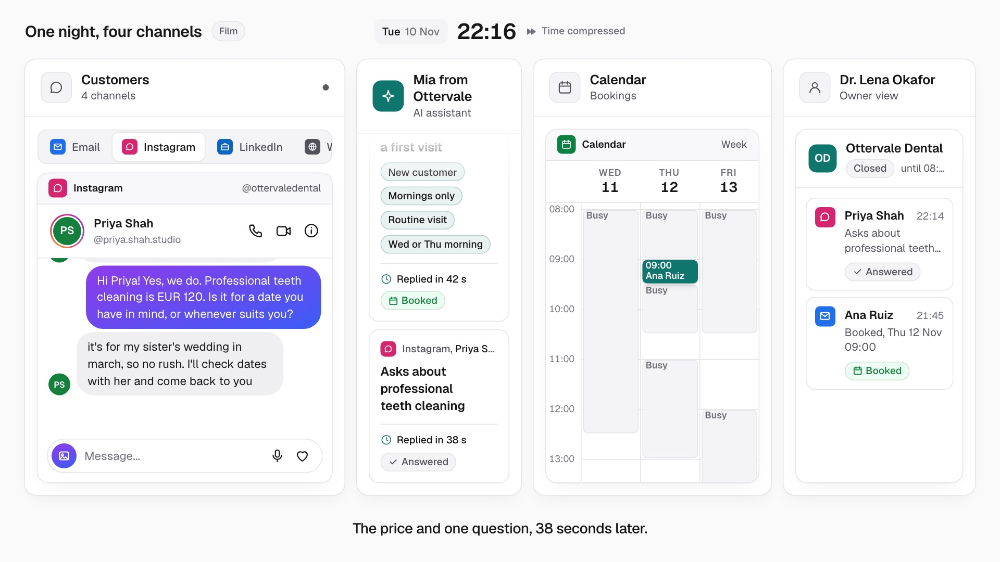
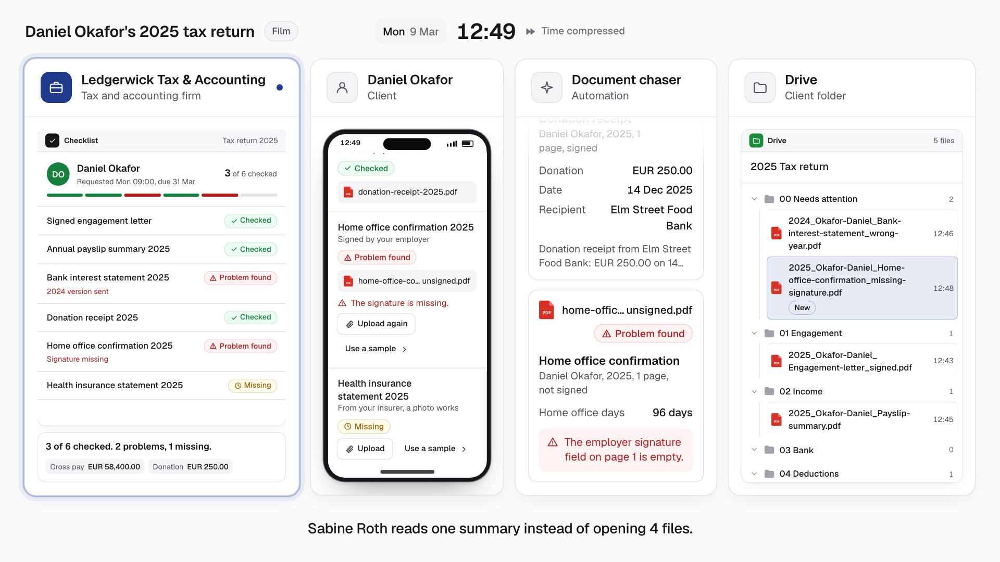
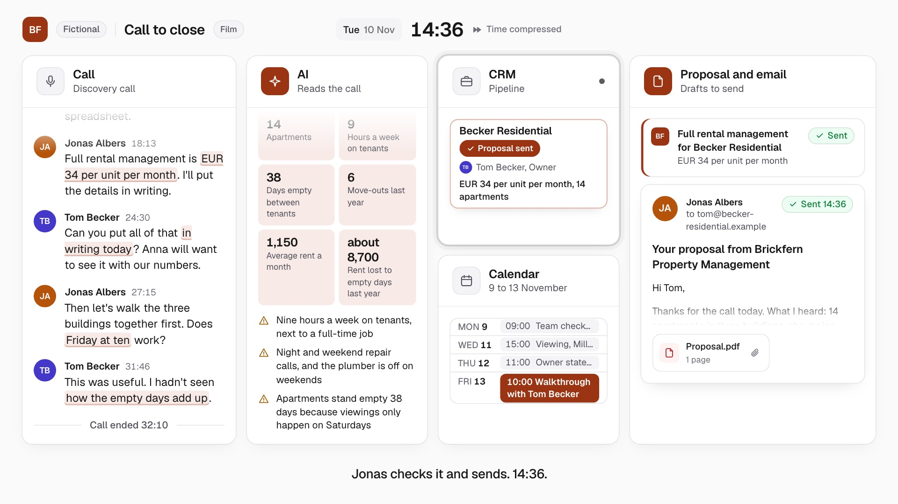

# diepen demos

Three working AI automations for service businesses, each with a short film and a live mode you can try in your own brand.
Built by [diepen.ai](https://diepen.ai).
Every company and person in them is fictional.

| Demo | What it shows | Ends on |
| --- | --- | --- |
| [Inbox autopilot](apps/inbox) | Every inquiry on email, Instagram, LinkedIn and website chat answered in the company's voice, qualified and booked into the calendar, with handover to a person when the policy says so | Reply time: 9 hours before, 38 seconds now |
| [Document chaser](apps/documents) | A client uploads and signs on one page; each file is checked, renamed and filed in Drive, and follow-ups name exactly what is missing | Hours a month chasing documents: 12 before, 1 now |
| [Call to close](apps/meetings) | A sales call transcript becomes a summary, the client's numbers, a CRM record, a proposal at your price, a follow-up email and the next meeting | Call end to proposal sent: 2 days before, 4 minutes now |





## Two modes

- **Film** (`/`): a scripted scenario plays like a short film, one lane per party, with compressed time and one number at the end. It runs from recorded fixtures, with no API key and no network.
- **Live** (`/live`): you play the customer, the client or the seller, and Claude answers for real.

**Make it yours** reads a website and drafts a company profile: name, logo, colours, tone of voice, policies and knowledge.
You can edit every field.
Live mode then runs in that company's brand and voice.
The profile stays in your browser and in the link you copy.

## Run it

You need Node 24 and pnpm 10.

```bash
pnpm install
```

```bash
pnpm dev:inbox
```

Open http://localhost:3101. The other demos run with `pnpm dev:documents` (port 3102) and `pnpm dev:meetings` (port 3103).

Without a key, live mode answers with a deterministic mock and the screen says so.
For real answers, copy `.env.example` to `apps/<demo>/.env.local` and set `ANTHROPIC_API_KEY`.

## Record a film

Open the film with `?record=1`, which hides the controls and the page chrome, on a 1920x1080 screen at 150% browser zoom.
The film then lays out at 1280x720 and the recording comes out at 1920x1080 with text large enough for a phone feed.
`?t=<milliseconds>` opens the film paused at that moment, which is how the stills above were taken.

## How it is built

pnpm workspaces and Turborepo, Next.js App Router, TypeScript strict, Tailwind and Geist.
Each app follows an onion architecture that lint enforces: `domain/` holds pure rules, `application/` holds use cases that receive their ports, `infrastructure/` holds the adapters and one composition root, and `app/` and `ui/` stay thin.

| Package | Holds |
| --- | --- |
| `packages/ai` | The `AiProvider` port, the Claude and mock adapters, cost guards and a request body reader with a hard byte cap |
| `packages/voice` | The `CompanyProfile` schema, three fictional presets, the system prompt builder every AI reply goes through, brand extraction from a website |
| `packages/ui` | Design tokens, the film engine, channel mockups (email, Instagram, LinkedIn, chat, Drive, CRM, calendar, transcript), brand theming and the demo shell |

Models: `claude-haiku-5-5` for chat replies, `claude-sonnet-5-5` for document checks, call outputs and brand extraction.
The document chaser reads files with Claude by default and can use Google Document AI for OCR (`OCR_PROVIDER=google-document-ai`).

Cost guards cap tokens per request, requests per minute per visitor and requests per day (`AI_MAX_OUTPUT_TOKENS`, `AI_RATE_LIMIT_PER_MINUTE`, `AI_DAILY_REQUEST_CAP`).
When a guard trips, the visitor lands on the film with a short note.

`skills/company-voice/SKILL.md` is a Claude skill that writes a `CompanyProfile` from a website, documents and sample emails.

## Checks

```bash
pnpm check
```

Lint, types, unit tests, the feature maps in `docs/features/`, the suppression count and every app's end-to-end tests against the mock provider.
Tests never call the real API.

## Deploy

Each app deploys to Vercel as its own project with the app folder as the root directory.
Set `ANTHROPIC_API_KEY` in the project's environment variables; the guard variables are optional.

## License

MIT. See [LICENSE](LICENSE).
